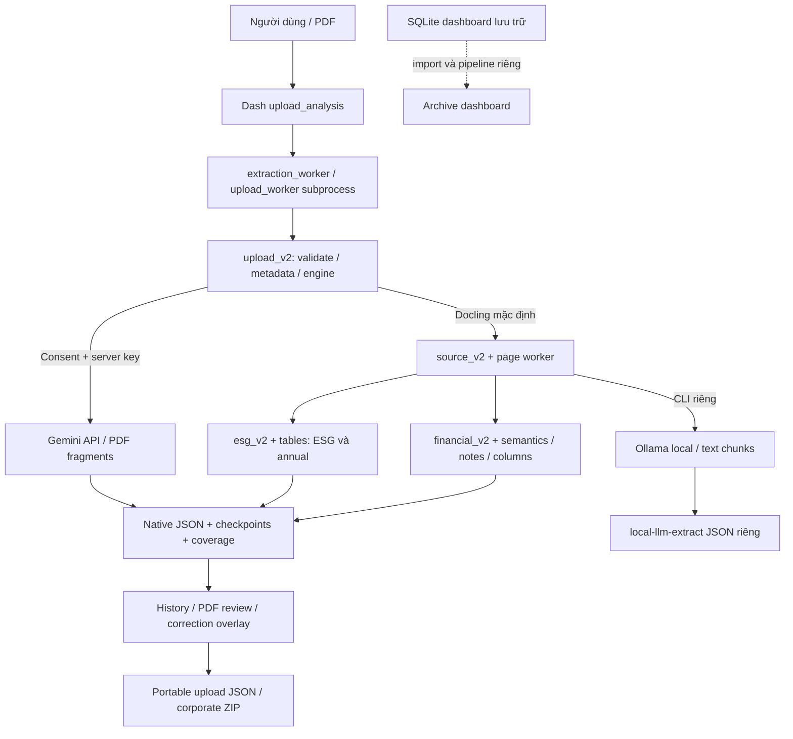
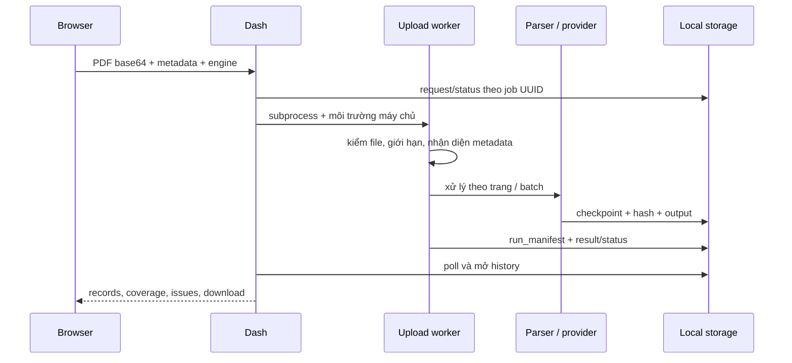
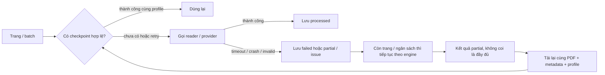

# 02. Kiến trúc và luồng dữ liệu

Ranh giới cloud chỉ ở Gemini được chọn rõ ràng. Local Docling có thể tải model khi
chưa có cache, nhưng không phải gọi LLM cloud để trích xuất. Ollama chỉ nhận origin
loopback và model đã cài, không tự pull hoặc fallback cloud. Không có REST service
extract công khai được triển khai; Dash callback là giao diện chính.

## Trình tự một upload

`request.json` chứa nội dung báo cáo base64, là dữ liệu nhạy cảm, dù không chứa API
key. Worker log không phải JSON protocol. PDF giữ nguyên bytes; chuẩn hóa/diễn giải
nằm trong record hoặc correction layer, không ghi đè nguồn.

## Lỗi và recovery thực tế

Docling capture có retry theo trang; OS workspace lock giải phóng khi process chết.
Gemini có request cap theo lượt, retry mặc định 0; 400/401/403/404/429 dừng batch
chưa gửi trong lượt đó. Trang pending không có nghĩa không công bố. Changing
code/profile/model/metadata có thể tạo cache mới, không chắc reuse hoặc không tốn phí.
Xem `source_v2.capture_pdf`, `gemini.extract_pdf`, `local_llm.extract_local_llm`.
